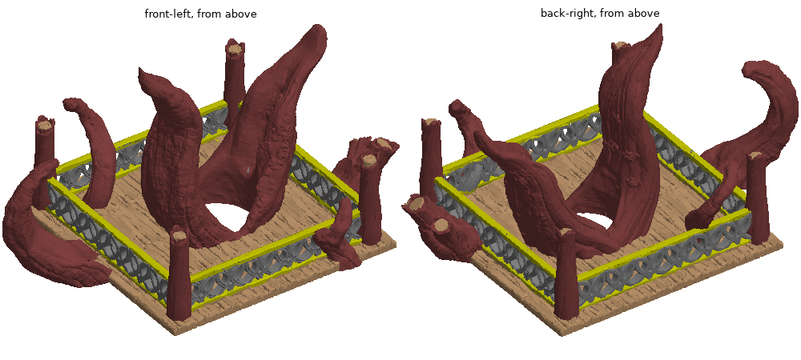

# Phase 1: ground truth and scoring

Reproduce: `python tools/phase1_report.py` (writes `out/top_truth.npz`, `out/base_truth.npz`,
`out/top_dec100k.npz`, `out/top_truth_preview.png`; ~70 s, dominated by decimation).

## paint_color decoding (VERIFIED)
Format confirmed against BambuStudio `TriangleSelector::serialize` / `FacetsAnnotation::get_triangle_as_string`:
hex nibbles stored last-nibble-first, bits LSB-first; per node bits 0-1 = split sides (0 = leaf), bits 2-3 = leaf
state or special side; state 3 escapes to further nibbles (`state-3`, each `F` adds 15); a split with s sides has
s+1 children serialized in reverse order. Child area fractions: 1 side [1/2,1/2], 2 sides [1/4,1/4,1/2],
3 sides [1/4]*4 (midpoint subdivision, shape-independent).

- Top (object 2): 1,000,954 tris, 866,993 painted, 15,527 distinct strings, **0 unparsable, 0 leftover nibbles**.
  22,403 subdivided triangles (3.54 % of area), max split depth 11, max state 4 = number of filaments in the project.
- Unpainted triangles (133,980; 9.06 % of area) get the object default. Object metadata says extruder 0 ("Default");
  resolved to filament 1. Confirmed two ways: the Bambu plate thumbnail shows the same colours as our render with
  this rule, and unpainted triangles share edges with F1-painted triangles 6,436 times vs 718 for F4, 2 for F3, 0 for F2.
- OBJ <-> 3MF: identical triangle order, same-index centroid distance <= 8.7e-6 mm after adding the source offset.
- Base (object 4, held out): 1,000,946 tris, 18,071 distinct strings, 0 unparsable. Area % per filament
  [65.09, 3.20, 30.44, 1.27]. Parsed only; nothing else was looked at.

## Sections (Top)

| filament | colour | area % | tris (dominant) | split-area % | what it covers (INFERRED from render) |
|---|---|---|---|---|---|
| F1 | #804040 dark red-brown | 38.78 | 513,547 | 2.08 | **Several parts:** the tree trunk and branches (largest component 52 % of F1, next branch 14 %) **and** the posts: short stump-like uprights at the corners and mid-sides of the deck (~6-8 components of ~4.4 % each). Also absorbs all unpainted default area. |
| F2 | #808080 grey | 17.03 | 186,919 | 3.82 | The railing loops: the ring/chain ornament between the rails. 4 large components = the 4 sides. z 5.7-24.7 mm. |
| F3 | #C4C400 yellow | 6.19 | 34,033 | 13.69 | The rails: top and bottom bars of the railing on each side (10 components > 0.5 %, ~8 bars + splits at posts). z 5.6-26.2 mm. Highest fraction of brush-split triangles, i.e. the hand paint relies on sub-triangle boundaries here most. |
| F4 | #BC946B tan | 38.01 | 266,455 | 3.23 | The deck: plank top, edges and underside as one component (99.2 % of F4), plus the sawn-off end faces of the posts and branches (small, z up to 59.5 mm). |

Component counts are by face adjacency within the dominant filament, on the full mesh.

## Scorer
`autocolor/score.py`. Reference and candidate are (N, k) area-per-label matrices. Overlap O[i,j] = area where the
reference says i and the candidate says j (exact for whole-triangle candidates; product coupling when both sides are
fractional). Candidate labels are mapped to sections first:
- `best` (headline): each candidate label -> the section it overlaps most (many-to-one).
- `one2one`: Hungarian assignment maximizing total overlap.

Per section: **IoU** (headline), recall (low = misses), precision (low = bleed). Overall = matched area / total area.

## Baseline: refs/TreetopDruidHaven-Top_autocolor_poc.3mf (VERIFIED)
Whole-triangle paint, 4 labels (PoC: 1 deck, 2 frame+posts, 3 railing, 4 tree), index-aligned with the OBJ.

Overlap, % of total area (rows = my sections, cols = PoC labels 1-4):

| | deck | frame+posts | railing | tree |
|---|---|---|---|---|
| F1 tree+posts | 0.82 | 7.85 | 0.26 | **29.84** |
| F2 loops | 0.04 | 0.87 | **16.08** | 0.04 |
| F3 rails | 0.53 | 0.70 | 4.95 | 0.01 |
| F4 deck | **14.23** | **23.55** | 0.09 | 0.14 |

**best mapping** (deck and frame+posts both -> F4; nothing maps to F3): **overall 83.70 %**

| section | area % | IoU | recall | precision |
|---|---|---|---|---|
| F1 tree+posts | 38.78 | 76.60 | 76.96 | 99.38 |
| F2 loops | 17.03 | 71.98 | 94.39 | 75.19 |
| F3 rails | 6.19 | **0.00** | 0.00 | - |
| F4 deck | 38.01 | 77.40 | 99.41 | 77.76 |

one2one mapping (forces deck -> F3): overall 70.00 %; F3 IoU 2.47, F4 IoU 49.67.

Reading: the PoC never separated rails from loops (F3 IoU 0; 4.95 % of total area of rails sits inside its railing
label, lowering F2 precision to 75). F1 recall 77 with precision 99 means the PoC's "tree" label misses ~23 % of
F1: the posts, which the PoC put in frame+posts (7.85 %), and that label maps to F4, which is why F4 precision is 78.
