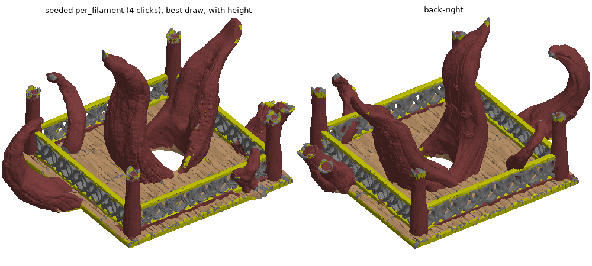

# Phase 2 checkpoint C: seeded method, first results (targets NOT met)

Reproduce: `python tools/phase2_seeded.py --draws 5 --height both --save-best` (~10 min). Log:
`phase2_seeded_table.log`. All scores in decimated space (100k copy; ceilings: overall 98.3, F1 97.9, F2 97.1,
F3 86.3, F4 97.0), identity mapping, 5 random click draws per condition.

## Score table (mean / worst of 5 draws, IoU %)

| condition | clicks | height | overall | F1 tree+posts | F2 loops | F3 rails | F4 deck |
|---|---|---|---|---|---|---|---|
| per_filament | 4 | with | 81.3 / 77.0 | 67.5 / 57.9 | 73.8 / 52.4 | 45.9 / 35.0 | 73.3 / 65.6 |
| per_filament | 4 | without | 76.7 / 74.8 | 60.3 / 52.3 | 74.5 / 53.0 | 42.9 / 36.5 | 63.0 / 50.0 |
| per_type | 6 | with | **88.6 / 86.7** | 86.8 / 77.4 | 79.0 / 66.4 | 41.8 / 26.6 | 81.0 / 77.3 |
| per_type | 6 | without | 80.2 / 62.3 | 74.8 / 51.2 | 78.0 / 64.1 | 42.6 / 30.0 | 60.0 / 15.2 |
| per_region_1 | 35 | with | 71.8 / 58.0 | 85.4 / 78.5 | 71.3 / 59.7 | 21.9 / 13.4 | 45.5 / 14.2 |
| per_region_1 | 35 | without | 71.3 / 57.9 | 81.5 / 65.9 | 70.9 / 58.2 | 24.5 / 14.6 | 42.8 / 12.0 |
| per_region_2 | 70 | with | 86.2 / 64.2 | 85.3 / 57.3 | 86.8 / 85.3 | 47.8 / 40.7 | 71.9 / 13.5 |
| per_region_2 | 70 | without | 85.7 / 62.7 | 84.2 / 55.0 | 85.0 / 82.4 | 51.7 / 45.6 | 70.2 / 9.4 |
| per_region_3 | 105 | with | 82.9 / 66.5 | 85.2 / 57.5 | 87.5 / 85.9 | 41.5 / 24.7 | 62.6 / 18.8 |
| per_region_3 | 105 | without | 81.8 / 64.8 | 83.8 / 55.4 | 87.1 / 86.3 | 42.1 / 25.4 | 59.4 / 13.9 |

Best single draws reach 92-94 overall (per_region_3 draw 0: 93.5, IoU 93.5 / 89.8 / 55.3 / 89.7), so the
pipeline can work; it is not robust to where the clicks land, and rails never exceed 57.

**The targets (>= 95 overall, every IoU >= 90) are not met in any condition.** The PoC baseline (83.7, best
mapping, full mesh) is beaten only on good draws.

## Does one click label all of its kind? (per_type, best draw, recall per region, * = clicked)
- posts (F1): clicked 87, others 86 83 77 93 88 88 87 -> **yes**, one post click labels all 8 posts (~85 %).
- loop sides (F2): 97 98 95* 97 -> **yes**.
- caps (F4): 100 100 100 97 95 100* -> **yes**, one cap click labels all 6 caps.
- rails (F3): 31 98 96 14 91* 15 19 89 -> **no**: 4 of 8 rails found, 4 lost (to loops / deck).
- slivers: F2 minor 100 0 4 100, F3 minor 0 0 0 (not clicked, tiny).

## Method as run (`autocolor/seeded.py: seeded_labels`)
1. Click patch: faces within 6 mm (affinity-weighted geodesic) of each click, one prototype per click.
2. Prior P(label | features) = per-click Gaussian kernel density (h = 1 in standardized log-feature space),
   max over the clicks of each label (so a label made of unlike parts, e.g. deck + caps, is not diluted).
3. Unary = -log P, seeds hard. Pairwise = Potts, lam 3 x edge length x crease factor x feature affinity, plus
   **through-solid links** (face <-> the face its inward normal ray hits, < 12 mm, anti-parallel, mutual within
   2 mm; weight 3 x median edge) so the two sides of a thin part share a label. Alpha-expansion (PyMaxflow,
   verified against brute force).
4. No geodesic pull, no self-training (both were tried and removed, see below).

## What was tried and what each failure taught (all VERIFIED on the decimated copy)
| variant | result | why |
|---|---|---|
| GBM on 4-6 mm click patches (first attempt) | 55-70 | patches are 2-33 decimated faces; a rail patch of 2 faces cannot train anything |
| geodesic pull to nearest seed (beta 3, tau 15-40) | per_filament 90-94 on good draws, per_region_1 55-60 | with 35 seeds the pull carves big regions by seed proximity: the single deck seed loses the deck to the 8 nearer post seeds (plain Voronoi of seeds scores 35) |
| per-edge feature affinity in the geodesic | no change | features are smooth at 1.5 mm: affinity at true part boundaries 0.82 vs 0.95 elsewhere, no barrier |
| label spreading (mesh + feature-kNN graph) | per_filament 80-90, per_region_1 55 | label mass scales with click count: 11 rail clicks on 3.5 % of faces overwhelm 1 deck click; rails took 81 % of the deck |
| self-training rounds (GBM on previous labels) | +1-3 points, then collapses (per_filament 89 -> 73, per_type 87 -> 63) | class-balanced retraining up-weights the small rail class's wrong faces x30 ("deck-like = rail"); unbalanced retraining drops rails to 0 |
| unsupervised over-segmentation (GMM 16 + cut) then click -> segment | 50-76 | segments are 96 % pure but 11k of them; a click labels one fragment, the GBM trained on 4 fragments is as weak as patches |
| KDE prior as mean over a label's samples | per_region_1 deck -> 2 % | deck patch is 1/7 of F4's samples (6 caps), its density diluted 7x |
| feature smoothing over 6-10 mm | no gain | |
| patch purity gate | no gain | per_region_1 failure is not patch impurity (mean purity 0.93-0.96) |
| through-solid links (unfiltered) | deck 17 -> 56-73 in per_region_1, but rails -> 0 | 70 % of rail links land on loops: rails are fused into the loop lattice, a rail-top ray exits through a loop |
| through-solid links, mutual only | rails safe, deck gain mostly lost | only 826 mutual links on the deck: the grooved top rarely rays back onto itself |

Two findings that bound this whole family of methods:
- **A GBM trained on representative labels scores 97.0 (resubstitution) / 0.99 AUC across regions.** The features
  are sufficient. Everything lost is lost in bootstrapping from clicks to a representative training set.
- **The deck underside is 21,700 mm^2, 18 % of the model, more than the deck top (9,800)**, thin (thick_min
  median 2.3 mm, textured) and reached by no click in any condition. Locally it looks like loops (prior: 78-98 %
  F2). The deck top is grooved planks whose groove faces look like bars. A "part" here is not locally homogeneous,
  so a prior built from a click's local look cannot cover it; the part has to be reached structurally (through
  the slab, along the surface) and the structural links I built were not strong enough on the textured deck.
- Rails are fused into the loop lattice and the bottom rail into the deck; only 30 % of boundary edges are creases.
  Rails are 3.5 % of faces: every method loses them first.

## Features changed in this step
Tangent extents are now the **max over depths 0.5-3 mm** inside the solid: deck-top faces read 8 mm wide at 0.5 mm
depth (plank grooves) but 20 mm at 2-3 mm, rails 5.6 at every depth. Rails/deck without height: 0.924 -> 0.950.

## Where this leaves the plan
Not ready for E/F; the method needs a different bootstrap before refinement makes sense. Candidates, in the order I
would try them (not started, awaiting review):
1. **Part-level linking that is robust to texture**: through-solid links from a smoothed/offset surface (cast from
   1-2 mm inside, or link face -> nearest face on the opposite side within a cone, not a single ray), so the deck
   top, underside and edges become one strongly-linked slab; same for rails across their width. Measure link
   same-label rate per class (now 93 % mutual, 89 % unfiltered, rails 30-47 %).
2. **Score-aware self-training**: retrain only on faces whose label is supported by both the classifier and the
   cut, keep class weights at the *current area share* (neither balanced nor raw), and reject a round that
   changes > 10 % of faces. The 97-point resubstitution result says this converges if the start is ~90.
3. Interactive protocol instead of fixed clicks: run, show, let the user add a click on the worst region
   (simulate: click the largest wrong region), repeat. This matches how the product will be used and would turn
   per_filament into ~8-10 clicks; worth measuring the clicks-to-target curve.

Stopping here for review.
