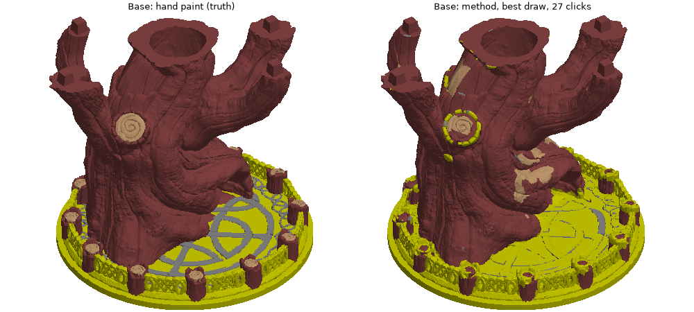

# Phase 3 checkpoint 1: full mesh, export, Base check

Reproduce: `python tools/phase3_fullmesh.py` (Top, ~3 min incl. refinement), `python tools/phase3_base_prep.py`
(~1 min), `python tools/phase2_interactive.py --model base --draws 5 --max-clicks 27 --prims 4 --save`,
`python tools/phase3_fullmesh.py --model base --labels out/base_interactive_draw4.npz --no-refine`.
Logs: `phase3_top_fullmesh.log`, `phase3_base_prep.log`, `phase3_base_final.log`, `phase3_top_link.log`,
`phase3_base_link.log`. Exports: `out/top_autocolor.3mf`, `out/base_autocolor.3mf` (never into refs/).

## 1a-1c Top: full mesh and export (VERIFIED, exact scoring, identity, invisible faces excluded)

| stage | overall | F1 | F2 loops | F3 rails | F4 deck |
|---|---|---|---|---|---|
| decimated result (draw 0, 20 clicks, primitives soft) | 92.8 | - | - | - | - |
| transferred to the full mesh (closest decimated face) | 93.41 | 90.54 | 86.15 | 69.03 | 88.90 |
| + full-mesh crease cut (changed 0.08 % of faces) | 93.46 | 90.58 | 86.37 | 69.11 | 88.98 |
| + sub-triangle refinement depth 2 (40,205 boundary tris, 24,636 split, 127 s) | **93.29** | 90.27 | 86.16 | 68.90 | 88.60 |
| export re-read | 93.29 | identical strings | | | |

- Transfer to the full mesh *gains* on rails (58 decimated -> 69 full): the closest-face transfer is finer than the
  decimated faces on thin parts. The full-mesh cut is nearly a no-op at this unary weight.
- **Refinement does not help (-0.17)**: with only per-face labels there is no sub-triangle information to recover;
  the vote-at-a-point label function reproduces the whole-triangle labels with noise. The oracle gain (rails
  94.5 -> 98.7) needs a label source with sub-triangle precision: a fitted primitive's surface, or the brush in the
  tool. Refinement stays in the code for those; export now uses depth 0 (whole triangles).
- **Export** writes a copy of your painted project with only the Top part file's `paint_color` strings replaced,
  project settings untouched, 60.4 MB. Re-reading it with our decoder gives byte-identical strings and the same
  score. You still need to open it in Bambu Studio once to confirm it displays (I cannot run the slicer).

## 1d Base (object 4, held out): the method does not transfer

Base facts: 1,000,946 tris, paint parses (18,071 strings, 0 unparsable). Invisible faces 5.6 % of area (Top 0.05 %).
Decimated ceiling 99.1. Paint: F1 65 % (one 103,555 mm^2 trunk + 12 stumps of ~780 mm^2), F3 30 % (a 47,491 mm^2
disc base + one 3,598 mm^2 part + 51 slivers), F2 3.2 % (16 small regions: an engraved inlay pattern on the disc),
F4 1.3 % (14 cut ends). per_type gives 7 initial clicks.

| condition (decimated, with rule) | overall mean / worst | F1 | F2 | F3 | F4 | clicks to 90 |
|---|---|---|---|---|---|---|
| 7 clicks (per_type) | 51.7 / 25.3 | 62.7 | 10.5 | 15.6 | 4.9 | - |
| 27 clicks (20 corrections) | **71.1 / 55.3** | 83.4 | 7.4 | 34.4 | 9.6 | never (best draw 88.5) |
| Top, same protocol, 20 clicks | 91.9 / 90.8 | 89.3 | 82.4 | 58.6 | 87.0 | 8.8 mean |

Best draw (88.5 decimated) on the full mesh: **88.6** overall; F1 87.2, F2 16.3, F3 80.6, F4 8.7; exported.

Junctions on Base (mean over draws, 27 clicks): every part-pair is 45-79 % wrong within 3 mm; the disc-inlay
junction (F2:main - F3:main) 78 %, stump-disc (F1:major - F3:main) 47 % with 1,425 mm misplaced. Top's worst
junction is 28 %.

Why, by part (INFERRED from the preview + features, VERIFIED numbers):
- **F2 inlay (3 %)**: a flat engraved pattern on the disc, same thickness and normals as the disc, only shallow
  grooves separate it. No shape feature carries it (thick 10 / curv 0.41 vs the disc's thin rough surface); it is a
  2D design, exactly what the slicer's fill tools do well. IoU 7-16.
- **F3 disc (30 %)**: the primitive fitter found it as a 9.2 mm "slab" with 82 % F3 in the claim (core/claim
  0.75, as planar as Top's deck). In the first run a *loop* click on the band's planar core labelled the whole
  claim F2 (-30 points); the F3 click fell outside the claim. That exposed the voting rule as fragile; the
  fix tried (primitives as same-label links instead of label voters) made Base worse (57.8) and Top slightly worse
  (91.6 vs 91.9, 5x slower solves), so it is not adopted. With 20 corrections the disc reaches 80 on the full mesh.
- **F1 trunk + stumps (65 %)**: 87-88 IoU; losses are F4-looking patches on the bark (tan patches in the preview)
  and the stump/disc bands. The 12 cylinders are all 100 % F1 (stumps and trunk limbs).
- **F4 cut ends (1.3 %)**: 14 small regions, 9 IoU; one cap click does not generalise here because the trunk's cut
  faces are bark-textured, unlike Top's smooth caps.
- Nothing was tuned on Base. Two things were changed after seeing it, both generic: junction part names fall back
  to raw type keys off Top, and the link-mode option exists (unused).

## Conclusion for the checkpoint
- Top: the pipeline is complete to a verified 3MF at 93.3 overall on the full mesh (F1 90, F2 86, F3 69, F4 89).
- Base: 71 mean / 88.6 best on the full mesh; the method handles the trunk and the disc, and cannot handle a flat
  inlay or bark-textured caps. The honest reading is that this method is a **first pass for 3D-distinct parts**,
  and the slicer does the rest; on Base "the rest" is the inlay, which is a 2D job anyway.
- Ready for Part 2 (the tool) on that basis, or stop here if Base's numbers change the decision.
